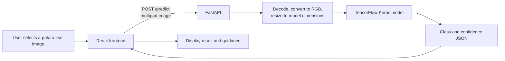

# 🌿 PlantCare AI

PlantCare AI is a web application that checks potato leaf photos for visual signs of **early blight**, **late blight**, or a **healthy** leaf. It combines a React-based upload interface with a FastAPI service that runs an image-classification model.

> This is an AI-assisted first check, not a guaranteed plant disease diagnosis. Results depend on the photo and the model.

## Overview

Identifying possible disease symptoms from leaf images can be difficult without a quick reference point. PlantCare AI lets a user upload or drag in a potato leaf image and receive a model prediction with a confidence score and class-specific guidance.

The frontend sends the selected image to the API for analysis. The API decodes the image, converts it to RGB, resizes it to the model's input dimensions, and returns the predicted class and confidence. The application supports three configured labels: **Early Blight**, **Late Blight**, and **Healthy**.

## Features

- Upload or drag and drop a JPG, JPEG, PNG, or WEBP image.
- Preview or replace the selected image before analysis.
- Receive an Early Blight, Late Blight, or Healthy classification.
- View the model's confidence score and guidance associated with the predicted class.
- Get visible loading, validation, and API error messages.
- Clear the selection and start over.
- Use the responsive single-page interface on smaller screens.

## Live demo and repository

- **Live frontend:** [https://dl-projet.vercel.app](https://dl-projet.vercel.app)
- **GitHub repository:** [DEVELOPER-MANISH007/DL-PROJET](https://github.com/DEVELOPER-MANISH007/DL-PROJET)
- **Configured API:** [https://dl-projet.onrender.com](https://dl-projet.onrender.com) — this endpoint returned HTTP 503 when checked while preparing this README. The frontend may not be able to analyze images until the API is available.

## Screenshots

No screenshots are currently included in the repository. To add them, capture the running application, save the images under `docs/images/`, and replace this note with Markdown image links, for example:

```md


```

## Technology stack

| Area | Technology |
| --- | --- |
| Frontend | React 18, TypeScript, Vite 6 |
| Styling | Tailwind CSS 4 and project CSS |
| Icons | Lucide React |
| API | Python, FastAPI, Uvicorn |
| Image processing and inference | Pillow, NumPy, TensorFlow |
| Model assets | Keras model files in `Models/` |
| Deployment configured in the project | Vercel frontend, Render API |

[](https://react.dev/)
[](https://www.typescriptlang.org/)
[](https://vite.dev/)
[](https://fastapi.tiangolo.com/)
[](https://www.tensorflow.org/)

## How it works



## Repository structure

```text
DL-PROJET/
├── api/
│   ├── main.py                 # FastAPI app, image preprocessing, inference endpoints
│   ├── requirements.txt        # Python dependencies (also listed at repository root)
│   └── README.md               # API deployment/configuration notes
├── frontend/
│   ├── src/
│   │   ├── App.tsx             # Upload flow and prediction interface
│   │   ├── index.css           # Application styles and responsive breakpoints
│   │   └── main.tsx            # React entry point
│   ├── index.html
│   ├── package.json
│   ├── package-lock.json
│   ├── tsconfig*.json
│   └── vite.config.ts
├── Models/
│   ├── 1.keras                 # Model loaded by the API
│   └── plant_disease_model.h5  # Additional tracked model file
├── ex.ipynb                    # Jupyter notebook
├── main.ipynb                  # Jupyter notebook
├── requirements.txt            # Python dependencies
└── .gitignore
```

`PlantVillage/` and `zips/` are ignored by Git and are not included in the tracked repository contents. The API's current inference path uses `Models/1.keras`.

## Prerequisites

- Python and `pip`. The repository does not pin a Python version or a TensorFlow version; choose a Python version supported by the TensorFlow package available for your platform.
- Node.js **18 or newer** and npm. The installed Vite 6 package declares support for Node.js 18, 20, and 22 or newer.
- The tracked model file `Models/1.keras`, required by the API at startup.

## Local development

Run the API from the repository root so its relative model path resolves correctly.

### 1. Install and start the API

Create and activate a virtual environment using your platform's usual method, then run:

```bash
python -m pip install -r requirements.txt
python -m uvicorn api.main:app --reload --host 127.0.0.1 --port 8000
```

The API is available at `http://127.0.0.1:8000`. Interactive API documentation is at `http://127.0.0.1:8000/docs`.

### 2. Install and start the frontend

In a second terminal:

```bash
cd frontend
npm ci
npm run dev
```

Open the local URL printed by Vite (by default, `http://localhost:5173`). The frontend uses `http://127.0.0.1:8000` as its API URL when `VITE_API_URL` is not set.

To point the frontend at a different API, create `frontend/.env` with:

```dotenv
VITE_API_URL=http://127.0.0.1:8000
```

Restart the Vite server after changing environment variables.

## Environment variables and configuration

| Variable | Used by | Purpose | Default |
| --- | --- | --- | --- |
| `VITE_API_URL` | Frontend | API base URL; the frontend appends `/predict`. Set this in the frontend's environment, without a trailing endpoint path. | `http://127.0.0.1:8000` |
| `CORS_ORIGINS` | API | Optional comma-separated list of additional exact frontend origins. Do not include paths or use `*`. | No additional origins |
| `PORT` | API | Port used by the Python entry point when run directly. | `8000` |

The API already permits the local Vite origins and `https://dl-projet.vercel.app`. Set `CORS_ORIGINS` on the API host if the frontend is served from another origin. Do not commit local `.env` files or place secrets in frontend variables: `VITE_` values are included in the browser build.

## Pages and API endpoints

The frontend is a single-page app with no client-side route configuration. Its main screen contains the upload panel, prediction result panel, and an informational footer.

| Method | Path | Purpose |
| --- | --- | --- |
| `GET` | `/` | API status and endpoint information |
| `GET` | `/ping` | Simple health check |
| `POST` | `/predict` | Accepts an image as multipart form field `file`; returns `{"class": "...", "confidence": 0.0}` |
| `GET` | `/docs` | FastAPI interactive API documentation |

`/predict` returns one of `Early Blight`, `Late Blight`, or `Healthy`, plus a confidence value. Invalid image data is rejected with HTTP 400.

## Build, testing, and deployment

### Build the frontend

```bash
cd frontend
npm ci
npm run build
```

The build runs the TypeScript project build and Vite production bundling. To serve the generated build locally:

```bash
npm run preview
```

There is no test script or automated test suite configured in `frontend/package.json` or in the tracked API files.

### Deploy

The [API deployment notes](api/README.md) describe a Vercel frontend and a Render API:

- **Frontend:** deploy the `frontend/` project with `npm ci` and `npm run build`; the Vite output directory is `dist`. Set `VITE_API_URL` in the hosting environment to the API base URL, then redeploy because Vite reads it at build time.
- **API:** install dependencies with `pip install -r requirements.txt` from the repository root. A Render-style start command documented for this project is:

  ```bash
  uvicorn api.main:app --host 0.0.0.0 --port $PORT
  ```

  Configure `CORS_ORIGINS` on the API host if using a frontend origin other than the one already allowed by the API.

The deployment URLs are documented in the repository, but the configured API returned HTTP 503 when checked for this README. Verify the API is responding before relying on the live image-analysis flow.

## Responsive design and accessibility

- The layout switches from two columns to a single column at narrower viewport widths, with additional small-screen styling.
- Interactive buttons and links have visible keyboard focus styles.
- The image input has an accessible label, previews have alternative text, status messages use live regions, and the confidence indicator exposes progress-bar semantics.
- CSS honors the reduced-motion preference.

These implementation details are not a substitute for a complete accessibility audit.

## Troubleshooting

- **The API will not start:** confirm that `Models/1.keras` exists at the repository root under `Models/`, install the Python dependencies, and start Uvicorn from the repository root.
- **The frontend cannot reach the API:** confirm the API is running, check `VITE_API_URL`, and allow the frontend's exact origin through the API's CORS configuration.
- **The deployed frontend still calls the wrong API:** set `VITE_API_URL` in the frontend hosting settings and rebuild/redeploy the frontend.
- **An image is rejected:** use a valid `.jpg`, `.jpeg`, `.png`, or `.webp` image.
- **The live analysis endpoint returns 503:** the configured API was returning this status when checked; confirm the backend deployment and its logs before retrying.
- **TensorFlow installation fails:** use a Python version and platform supported by the TensorFlow distribution you are installing. This repository does not pin either version.

## Potential future improvements

- Add automated tests for API image validation, response shape, and frontend upload states.
- Pin and document supported Python and TensorFlow versions.
- Add model evaluation details and explain how the model was trained.
- Add screenshots and a short end-to-end demo.
- Add upload-size limits and deployment-specific operational guidance.

## Contributing

Contributions are welcome:

1. Fork the repository and create a focused branch.
2. Make a change that reflects the behavior actually implemented.
3. Run `npm run build` for frontend changes and verify API changes locally where practical.
4. Open a pull request with a concise description and relevant screenshots or test information.

Do not commit secrets, local environment files, generated build output, or large ignored dataset archives.

## License

No `LICENSE` file or license declaration is present in the tracked repository. Until a license is added, reuse and redistribution permissions are not specified.

## Developer

**Manish Kumar** — [GitHub profile](https://github.com/Developer-Manish007)
